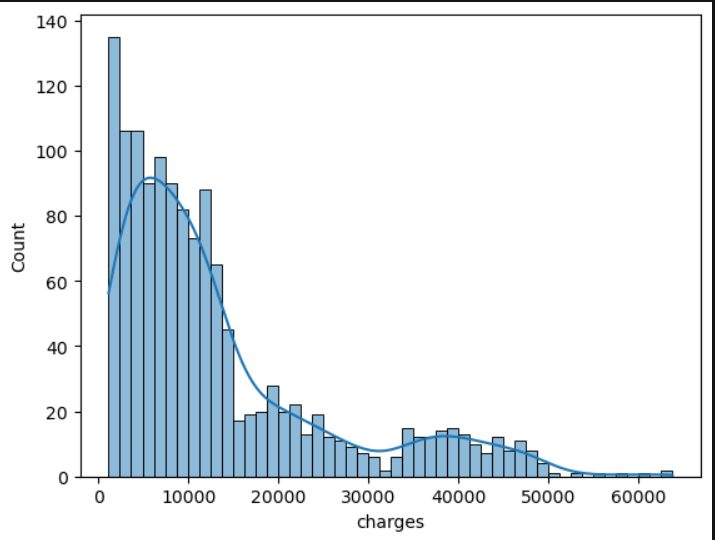
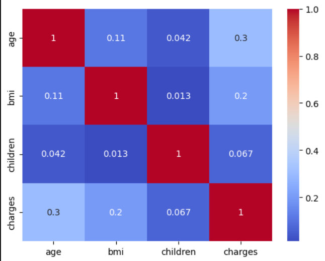
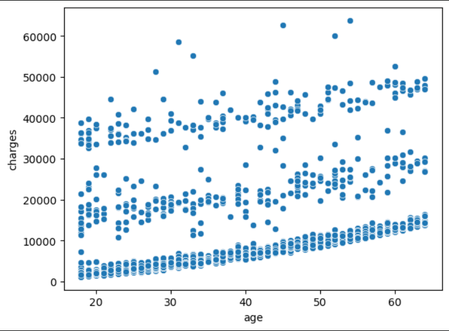
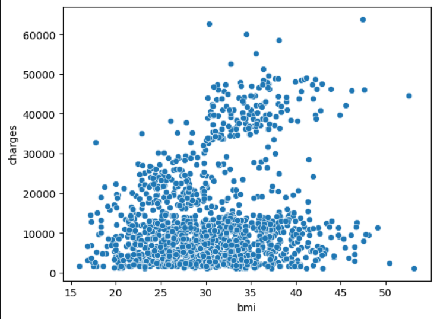
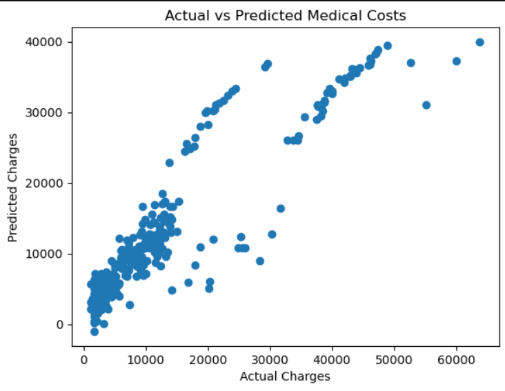

# Medical Insurance Cost Prediction

A machine learning project that predicts medical insurance charges using **Multiple Linear Regression** with Python and Scikit-learn.

## Overview

This project explores a medical insurance dataset to understand the factors associated with insurance charges and build a regression model to predict costs. It covers data exploration, preprocessing, feature engineering, model training, and evaluation.

## Dataset Features

| Feature | Description |
|---|---|
| `age` | Age of the individual |
| `sex` | Sex of the individual |
| `bmi` | Body Mass Index |
| `children` | Number of children covered by insurance |
| `smoker` | Smoking status |
| `region` | Residential region |
| `charges` | Medical insurance charges (target variable) |

**Dataset:** The CSV file is not included in this repository. Obtain the dataset from its original source and place `insurance.csv` in the appropriate directory before running the notebook.

## Tools & Libraries

- Python
- Pandas
- NumPy
- Matplotlib
- Seaborn
- Scikit-learn
- Jupyter Notebook

## Project Workflow

1. **Data Inspection** — Examined dataset structure, descriptive statistics, missing values, and duplicate records.
2. **Exploratory Data Analysis (EDA)** — Explored insurance charge distributions and relationships between features using visualizations and correlation analysis.
3. **Data Preprocessing** — Removed duplicate records and encoded categorical variables using one-hot encoding.
4. **Feature Engineering** — Created an interaction feature between age and smoking status.
5. **Model Training** — Split the data into training and testing sets and trained a Multiple Linear Regression model.
6. **Model Evaluation** — Evaluated predictions using R² Score, Mean Squared Error (MSE), and Root Mean Squared Error (RMSE).

## Visualizations

### 1. Insurance Charges Distribution



### 2. Correlation Heatmap



### 3. Age vs Insurance Charges



### 4. BMI vs Insurance Charges



### 5. Actual vs Predicted Charges



## Model Evaluation

The model's performance is evaluated using:

- **R² Score** — Measures how much variation in insurance charges is explained by the model.
- **Mean Squared Error (MSE)** — Measures the average squared difference between actual and predicted charges.
- **Root Mean Squared Error (RMSE)** — Measures prediction error in the same units as insurance charges.

The notebook includes the evaluation results and a comparison of actual and predicted values.

## Project Structure

```text
medical-insurance-cost-prediction/
├── images/
│   ├── charges-distribution.png
│   ├── correlation-heatmap.png
│   ├── age-vs-charges.png
│   ├── bmi-vs-charges.png
│   └── actual-vs-predicted.png
├── medical_insurance_cost_prediction.ipynb
└── README.md
```

## Key Learning Outcomes

- Exploratory Data Analysis
- Categorical feature encoding
- Feature engineering
- Multiple Linear Regression
- Regression model evaluation

---
